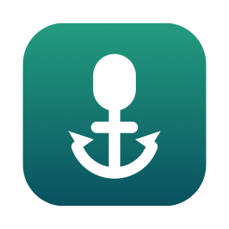

<p align="center"></p>

# FixMacAudioInput

**Stop macOS from hijacking your microphone (and speakers) every time you connect headphones.**

[Português](README.pt-BR.md)

Every time you connect AirPods, a Bluetooth headset or a USB dongle, macOS silently makes it the
default **input** and **output**. Your good microphone gets replaced by the headset mic, and on
Bluetooth the audio drops to low-quality "call mode". FixMacAudioInput is a tiny native menu bar app
that switches it back — instantly, without asking.

## Features

- **Undoes automatic switches.** When macOS switches to a device that was *just* connected, the app
  restores the device you were using before.
- **Respects your choices.** Pick a device yourself (in Sound settings, the menu bar or the app) and
  it becomes the new preferred one. Nothing to configure.
- **Input and output, independently.** By default only the **input** is pinned (headphones still
  play audio). Turn on *Keep fixed* for the output too if you want.
- **Sound effects too.** If the output is pinned, alert sounds are also kept off the new device.
- **Remembers disconnected devices.** If your preferred USB mic is unplugged, macOS falls back to
  something else; when the mic comes back, it is restored.
- **Lives in the menu bar.** The mic icon shows the state (crossed out = paused). Its menu lets you
  pause, pick the preferred input/output, toggle *Keep fixed* and open settings & history. No Dock icon.
- **Open at login**, history of every action, log file at `~/Library/Logs/FixMacAudioInput.log`.
- **Languages:** English, Português (Brasil), Español, Français, Deutsch — follows the system
  language (or the per-app setting in System Settings › General › Language & Region).
- Native Swift/SwiftUI, universal binary (Apple silicon + Intel), no network, no microphone access,
  no dependencies.

## Install

1. Download the latest `FixMacAudioInput-x.y.z.dmg` (or `.zip`) from
   [Releases](../../releases).
2. Drag **FixMacAudioInput** to **Applications** and open it.
3. The build is **not notarized** (ad-hoc signed), so the first launch is blocked by Gatekeeper.
   Either right-click the app › **Open** › **Open**, or go to System Settings › Privacy & Security ›
   **Open Anyway**. Alternatively:

   ```sh
   xattr -dr com.apple.quarantine /Applications/FixMacAudioInput.app
   ```

4. Optional: enable **Open at login** in the menu.

The settings window shows up on the very first launch only. After that, use the mic icon in the
menu bar (opening the app again from Finder also brings the window back).

Requires macOS 14 Sonoma or later.

## How it works

The app listens to CoreAudio's `kAudioHardwarePropertyDevices`,
`kAudioHardwarePropertyDefaultInputDevice`, `kAudioHardwarePropertyDefaultOutputDevice` and
`kAudioHardwarePropertyDefaultSystemOutputDevice`.

| Event | What the app does |
|---|---|
| Default changes to a device first seen **less than 8 s ago** | Automatic switch → restore the preferred device |
| Default changes to a device that was already connected | Your choice → it becomes the preferred device |
| Preferred device disconnects | Keep the preference; restore it when the device returns |
| Protection paused or *Keep fixed* off | Just follow whatever is selected |

Side effect: if you manually pick a brand-new device within 8 seconds of connecting it, the app
will treat it as automatic and switch back. Wait a few seconds, or choose it in the app window.

## Build from source

Needs Xcode (or the Command Line Tools) with Swift 5.9+.

```sh
./build.sh              # build/FixMacAudioInput.app + build/simulate_plug
./build.sh --install    # also copies the app to /Applications
./build.sh --package    # also creates dist/*.zip, dist/*.dmg and SHA-256 sums
SIGN_IDENTITY="Developer ID Application: You (TEAMID)" ./build.sh --package
```

No Xcode project: `build.sh` calls `swiftc` directly, builds both architectures and assembles the
bundle (icon, localizations, Info.plist, signature).

## Test

`build/simulate_plug` creates a temporary public aggregate device — macOS sees it as a newly
connected device — sets it as the default exactly like macOS does with headphones, and checks what
the running app did. Your previous default is restored afterwards.

```sh
open build/FixMacAudioInput.app --args -protectOutput YES   # pin output too, for this run only
build/simulate_plug input auto      # expects PASS: automatic switch undone
build/simulate_plug input manual    # expects PASS: manual choice respected (switch after 10 s)
build/simulate_plug output auto
build/simulate_plug output manual
```

## Project layout

```
Sources/
  CoreAudioHelpers.swift   thin CoreAudio wrapper (devices, defaults, listeners)
  AudioGuard.swift         the switching rules
  ContentView.swift        SwiftUI window + login item
  L10n.swift               localized string lookup
  main.swift               AppKit app delegate, menu bar item, single instance
Resources/
  Info.plist
  Localization/<lang>.lproj/Localizable.strings
  generate_icon.swift      renders the app icon from SF Symbols
Tests/main.swift           simulate_plug end-to-end checker
build.sh
```

## Adding a language

Copy `Resources/Localization/en.lproj` to `<code>.lproj`, translate the values (keep the `%@` /
`%1$@` placeholders), add the code to `CFBundleLocalizations` in `Resources/Info.plist` and rebuild.

## License

[MIT](LICENSE) © 2026 Pedro Beraldo. Not affiliated with Apple.
