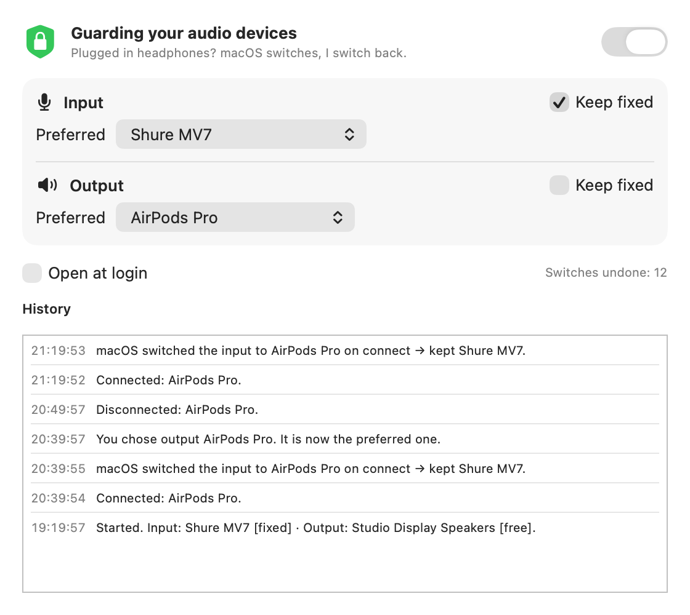

<p align="center"></p>

<h1 align="center">FixMacAudioInput</h1>

<p align="center"><b>Your microphone stays put.</b><br>
A tiny menu bar app that stops macOS from switching your microphone (and speakers) every time you connect headphones.</p>

<p align="center">
  <a href="https://github.com/pedroberaldo87/FixMacAudioInput/releases/latest"></a>
  <a href="https://github.com/pedroberaldo87/FixMacAudioInput/actions/workflows/build.yml"></a>
  
  
  <a href="LICENSE"></a>
</p>

<p align="center">
  <a href="https://github.com/pedroberaldo87/FixMacAudioInput/releases/latest"><b>Download</b></a> ·
  <a href="https://pedroberaldo87.github.io/FixMacAudioInput/">Website</a> ·
  <a href="README.pt-BR.md">Português</a>
</p>

<p align="center"></p>

## The problem

Every time you connect AirPods, a Bluetooth headset or a USB dongle, macOS silently makes it the
default **input** and **output**. Your good microphone gets replaced by the headset mic, and on
Bluetooth the audio drops to low-quality "call mode". FixMacAudioInput notices the automatic switch
and puts your previous device back — in under a second, without asking.

## Features

- **Undoes automatic switches.** When macOS switches to a device that was *just* connected, the app
  restores the device you were using before.
- **Respects your choices.** Pick a device yourself (Sound settings, Control Center, or the app's
  menu) and it becomes the new preferred one. Nothing to configure.
- **Input and output, independently.** By default only the **input** is pinned, so headphones still
  play audio. Turn on *Keep fixed* for the output too if you want.
- **Sound effects too.** With the output pinned, alert sounds also stay off the new device.
- **Remembers unplugged devices.** Unplug your USB mic and plug it back later: it is restored.
- **Lives in the menu bar.** Its microphone-with-padlock icon shows the state (crossed out = paused).
  The menu lets you pause, pick the preferred input/output, toggle *Keep fixed*, open settings &
  history and enable **Open at login**. No Dock icon.
- **History.** Every action is listed in the window and written to
  `~/Library/Logs/FixMacAudioInput.log`.
- **Languages:** English, Português (Brasil), Español, Français, Deutsch — follows the system
  language (or the per-app setting in System Settings › General › Language & Region).
- **Native and private.** Swift + SwiftUI, universal binary (~1 MB). No network, no microphone
  access, no analytics, no dependencies.

## Install

1. Download the latest `FixMacAudioInput-x.y.z.dmg` from [Releases](https://github.com/pedroberaldo87/FixMacAudioInput/releases/latest).
2. Open it and drag **FixMacAudioInput** to **Applications**.
3. Releases are **ad-hoc signed and not notarized**, so Gatekeeper blocks the first launch.
   Right-click the app › **Open** › **Open**, or go to System Settings › Privacy & Security ›
   **Open Anyway**. Or in Terminal:

   ```sh
   xattr -dr com.apple.quarantine /Applications/FixMacAudioInput.app
   ```

4. Find the microphone-with-padlock icon in the menu bar and turn on **Open at login**.

The settings window opens by itself only on the very first launch. After that, use the menu bar
icon (opening the app again from Finder or Spotlight also brings the window back).

Verify a download with the `.sha256` file attached to each release:

```sh
shasum -a 256 -c FixMacAudioInput-x.y.z.sha256
```

## How it works

The app listens to CoreAudio's `kAudioHardwarePropertyDevices`,
`kAudioHardwarePropertyDefaultInputDevice`, `kAudioHardwarePropertyDefaultOutputDevice` and
`kAudioHardwarePropertyDefaultSystemOutputDevice`.

| When | What the app does |
|---|---|
| The default changes to a device first seen **less than 8 s ago** | Automatic switch → restore the preferred device |
| The default changes to a device that was already connected | Your choice → it becomes the preferred device |
| The preferred device disconnects | Keep the preference; restore it when the device returns |
| Protection paused or *Keep fixed* off | Just follow whatever is selected |

Edge case: if you manually pick a brand-new device within 8 seconds of connecting it, the app treats
it as automatic and switches back. Wait a few seconds, or choose it from the app's menu.

## FAQ

**Why not just pick the microphone in System Settings?** You can — and macOS overrides it again the
next time a device connects. That is the behavior this app undoes.

**Does it listen to my microphone or use the network?** No. It only reads and sets the default
device through CoreAudio. It never opens an audio stream, never asks for microphone permission and
makes no network connections.

**Will my AirPods still play sound?** Yes. Only the input is pinned by default. While the headset
mic is not in use, Bluetooth headphones usually stay in their high-quality playback mode.

**What if I want to talk through the headset?** Choose it in the app's menu (or in Sound settings a
few seconds after connecting). You can also turn off *Keep fixed* or pause protection.

## Uninstall

Quit it from the menu, turn off **Open at login**, delete `/Applications/FixMacAudioInput.app`, and
optionally remove its settings and log:

```sh
defaults delete br.com.pedroberaldo.FixMacAudioInput
rm ~/Library/Logs/FixMacAudioInput.log
```

## Build from source

Needs Xcode or the Command Line Tools (Swift 5.9+). No Xcode project, no dependencies.

```sh
git clone https://github.com/pedroberaldo87/FixMacAudioInput.git
cd FixMacAudioInput
./build.sh              # build/FixMacAudioInput.app + build/simulate_plug
./build.sh --install    # also copies the app to /Applications
./build.sh --package    # also creates dist/*.zip, dist/*.dmg and SHA-256 sums
SIGN_IDENTITY="Developer ID Application: You (TEAMID)" ./build.sh --package
```

`build.sh` calls `swiftc` directly, builds arm64 and x86_64, and assembles the bundle (icon,
localizations, Info.plist, signature).

## Test

`build/simulate_plug` creates a temporary public aggregate device — macOS sees it as a newly
connected device — makes it the default exactly like macOS does with headphones, and checks what
the running app did. Your previous default is restored afterwards.

```sh
open build/FixMacAudioInput.app --args -protectOutput YES   # pin output too, for this run only
build/simulate_plug input auto      # PASS: automatic switch undone
build/simulate_plug input manual    # PASS: manual choice respected (switch after 10 s)
build/simulate_plug output auto
build/simulate_plug output manual
```

## Project layout

```
Sources/
  AudioGuard.swift         the switching rules
  CoreAudioHelpers.swift   thin CoreAudio wrapper (devices, defaults, listeners)
  ContentView.swift        SwiftUI settings window + login item
  StatusIcon.swift         the microphone-with-padlock glyph (menu bar + app icon)
  L10n.swift               localized string lookup
  main.swift               app delegate, menu bar item and menu, single instance
Resources/
  Info.plist
  Localization/<lang>.lproj/Localizable.strings
Tests/main.swift           simulate_plug end-to-end checker
Tools/
  generate_icon/           renders AppIcon.iconset from StatusIcon
  screenshot/              renders docs/screenshots with demo data
docs/                      website (GitHub Pages)
build.sh
```

## Contributing

Bug reports, translations and pull requests are welcome — see [CONTRIBUTING.md](CONTRIBUTING.md).

## License

[MIT](LICENSE) © 2026 Pedro Beraldo. Not affiliated with Apple. macOS and AirPods are trademarks of
Apple Inc.
