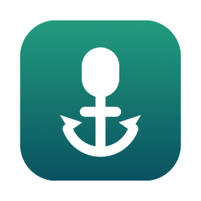
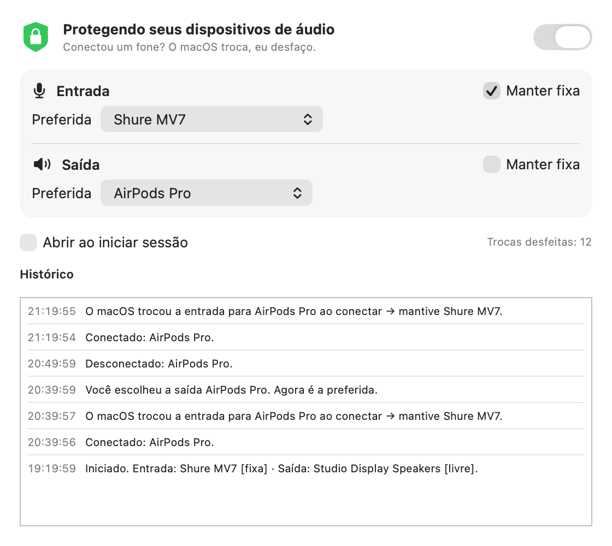

<p align="center"></p>

<h1 align="center">FixMacAudioInput</h1>

<p align="center"><b>Seu microfone fica onde está.</b><br>
Um app pequenino de barra de menus que impede o macOS de trocar seu microfone (e alto-falantes) toda vez que você conecta um fone.</p>

<p align="center">
  <a href="https://github.com/pedroberaldo87/FixMacAudioInput/releases/latest"></a>
  <a href="https://github.com/pedroberaldo87/FixMacAudioInput/actions/workflows/build.yml"></a>
  
  <a href="LICENSE"></a>
</p>

<p align="center">
  <a href="https://github.com/pedroberaldo87/FixMacAudioInput/releases/latest"><b>Baixar</b></a> ·
  <a href="https://pedroberaldo87.github.io/FixMacAudioInput/">Site</a> ·
  <a href="README.md">English</a>
</p>

<p align="center"></p>

## O problema

Sempre que você conecta AirPods, um headset Bluetooth ou um dongle USB, o macOS transforma o
aparelho na **entrada** e na **saída** padrão sem perguntar. Seu microfone bom vira o microfone do
fone e, no Bluetooth, o áudio cai para o "modo chamada", de baixa qualidade. O FixMacAudioInput
percebe a troca automática e devolve o aparelho anterior em menos de um segundo.

## O que faz

- **Desfaz trocas automáticas.** Quando o macOS troca para um aparelho que *acabou* de conectar, o
  app volta para o que você usava antes.
- **Respeita suas escolhas.** Escolheu um aparelho (Ajustes de Som, Central de Controle ou o menu do
  app)? Ele vira o novo preferido. Nada para configurar.
- **Entrada e saída independentes.** Por padrão só a **entrada** fica fixa (o fone continua tocando
  o som). Ligue *Manter fixa* na saída se quiser.
- **Efeitos sonoros também.** Com a saída fixa, os sons de alerta também não vão para o aparelho novo.
- **Lembra de aparelhos desplugados.** Desplugou o mic USB e plugou depois? Ele volta sozinho.
- **Fica na barra de menus.** O ícone de microfone com cadeado mostra o estado (riscado = pausado).
  O menu pausa, escolhe entrada/saída preferida, liga *Manter fixa*, abre ajustes e histórico e liga
  **Abrir ao iniciar sessão**. Sem ícone na Dock.
- **Histórico** na janela e em `~/Library/Logs/FixMacAudioInput.log`.
- **Idiomas:** English, Português (Brasil), Español, Français, Deutsch, seguindo o idioma do sistema.
- **Nativo e privado.** Swift + SwiftUI, binário universal (~1 MB). Sem rede, sem acesso ao
  microfone, sem analytics, sem dependências.

## Instalação

1. Baixe o `FixMacAudioInput-x.y.z.dmg` mais recente em [Releases](https://github.com/pedroberaldo87/FixMacAudioInput/releases/latest).
2. Abra e arraste o **FixMacAudioInput** para **Aplicativos**.
3. As versões são **assinadas ad-hoc e não notarizadas**, então o Gatekeeper bloqueia a primeira
   abertura. Clique com o botão direito no app › **Abrir** › **Abrir**, ou vá em Ajustes do Sistema
   › Privacidade e Segurança › **Abrir Mesmo Assim**. Ou no Terminal:

   ```sh
   xattr -dr com.apple.quarantine /Applications/FixMacAudioInput.app
   ```

4. Procure o ícone de microfone com cadeado na barra de menus e ligue **Abrir ao iniciar sessão**.

A janela de ajustes só abre sozinha na primeira execução. Depois, use o ícone na barra de menus
(abrir o app de novo pelo Finder ou Spotlight também traz a janela).

## Como funciona

| Quando | O que o app faz |
|---|---|
| O padrão muda para um aparelho visto pela primeira vez **há menos de 8 s** | Troca automática → volta para o preferido |
| O padrão muda para um aparelho que já estava conectado | Escolha sua → vira o preferido |
| O preferido desconecta | Mantém a preferência e restaura quando ele voltar |
| Proteção pausada ou *Manter fixa* desligado | Só acompanha o que estiver selecionado |

Caso de borda: se você escolher manualmente um aparelho nos primeiros 8 segundos depois de
conectá-lo, o app entende como automático e desfaz. Espere alguns segundos ou escolha pelo menu do app.

## Desinstalar

Encerre pelo menu, desligue **Abrir ao iniciar sessão**, apague `/Applications/FixMacAudioInput.app`
e, se quiser, os ajustes e o log:

```sh
defaults delete br.com.pedroberaldo.FixMacAudioInput
rm ~/Library/Logs/FixMacAudioInput.log
```

## Compilar e testar

Precisa do Xcode ou das Command Line Tools (Swift 5.9+). Sem projeto Xcode e sem dependências.

```sh
git clone https://github.com/pedroberaldo87/FixMacAudioInput.git
cd FixMacAudioInput
./build.sh --install                 # compila e instala em /Applications
open build/FixMacAudioInput.app --args -protectOutput YES
build/simulate_plug input auto       # esperado: PASS: automatic switch undone
build/simulate_plug input manual     # esperado: PASS: manual choice respected
```

Detalhes de build, testes e estrutura no [README em inglês](README.md).

## Licença

[MIT](LICENSE) © 2026 Pedro Beraldo. Sem vínculo com a Apple.
